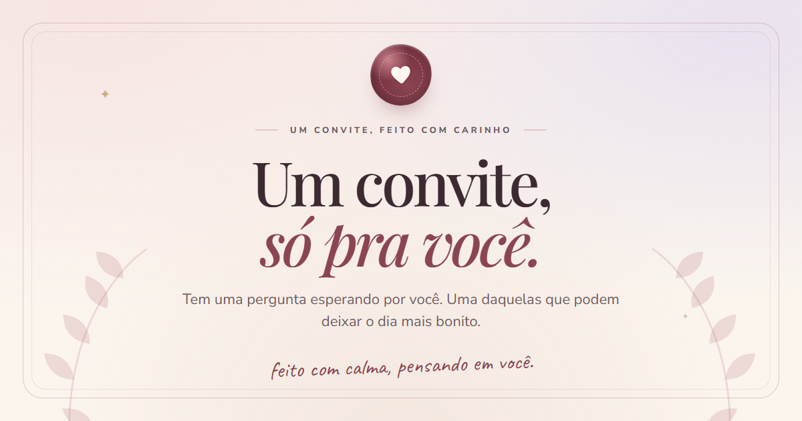

# Um convite, só pra você 💗

Um site-convite interativo para chamar alguém para sair. A experiência começa como um envelope de papel, passa por uma celebração e termina em um date combinado — com direito a música, calendário e mensagem pronta no WhatsApp.



Quase todo o conteúdo é configurável em um único arquivo, e o site é 100% estático: não há backend, banco de dados, login ou serviço pago.

## O que a experiência tem

- **Boas-vindas** com envelope ilustrado e convite para abrir a surpresa.
- **O convite** com dois botões: o “sim” fica no lugar; o “não” foge sempre que alguém tenta alcançá-lo. A brincadeira é infinita e não existe caminho de recusa pela interface.
- **Celebração** em uma cena escura e imersiva, com confete, corações e revelação do “sim”.
- **Escolha do programa** entre seis ideias (cinema, jantar, sorvete/açaí, café, passeio surpresa ou uma ideia escrita pela pessoa).
- **Dia e horário** em um calendário acessível, com opção de “combinar depois” e observações opcionais.
- **Resumo** para revisar e alterar qualquer escolha antes de confirmar.
- **Final:** cartão do date, contagem regressiva, mensagem pronta no WhatsApp, link para o Google Calendar e download de um evento `.ics`.
- **Persistência local:** recarregar a página não perde o progresso. Há um botão para recomeçar do zero.
- **Música** original em loop, ativada por um toque (respeitando a política de autoplay dos navegadores).
- **Responsivo e acessível:** funciona de 320px a telas grandes, com navegação por teclado, foco visível, erros anunciados e suporte a `prefers-reduced-motion`.
- **Privacidade por padrão:** sem analytics, sem cookies e sem envio de dados para servidores. O site também declara `noindex, nofollow`.

## Stack

- [Nuxt 3](https://nuxt.com/) com Vue 3 e TypeScript
- [Tailwind CSS 4](https://tailwindcss.com/) via plugin do Vite
- [Lucide](https://lucide.dev/) para os ícones
- [Vitest](https://vitest.dev/) para os testes
- Fontes self-hosted: Playfair Display, Nunito Sans e Caveat (licenças OFL em `public/fonts/`)
- Geração estática com Nitro, pronta para Vercel ou qualquer hospedagem de arquivos estáticos

## Rodando localmente

Requisitos: **Node.js 20+** e **Yarn 1.22** (o projeto versiona o `yarn.lock`).

```bash
yarn install
yarn dev
```

Abra `http://localhost:3000`.

Se você não tiver o Yarn instalado globalmente:

```bash
npx -y yarn@1.22.22 install
npx -y yarn@1.22.22 dev
```

Outros comandos:

```bash
yarn test        # testes unitários com Vitest
yarn test:watch  # testes em modo watch
yarn typecheck   # checagem de tipos do Nuxt/Vue
yarn generate    # build estático em .output/public
yarn preview     # pré-visualiza o build de produção
```

## Personalizando

Quase tudo que é pessoal vive em [`config/romantic.config.ts`](config/romantic.config.ts).

### Checklist antes de publicar

| O que mudar | Onde | Observações |
| --- | --- | --- |
| Nome de quem recebe | `recipientName` | Aparece nas mensagens que usam `{nome}`. Sem nome, o texto usa “você”. |
| Seu nome | `senderName` | Usado em `{remetente}` e na assinatura do cartão final. |
| Número do WhatsApp | `whatsappNumber` | Apenas dígitos, com DDI + DDD. Ex.: `5511987654321`. |
| URL do site | `siteUrl` | Ex.: `https://nossoconvite.com`. Necessário para canonical e imagem de compartilhamento absoluta. |
| Título e descrição | `siteTitle`, `siteDescription` | Aparecem na aba e nos cards de compartilhamento. |
| Mensagens | `messages` | Todos os textos da experiência. |
| Programas | `dateOptions` | Cada opção tem `id`, `icon`, `emoji`, `title`, `description` e `accent`. |
| Horários | `schedule.timeSlots` | Lista de horários no formato `HH:MM`. |
| Calendário | `calendar` | Título, descrição, duração, fuso e local do evento. |
| Música | `music` | `enabled`, `src`, `title`, `artist` e `volume` inicial. |
| Cores | `theme` | Tokens aplicados como CSS custom properties. |

> **Importante:** o número de WhatsApp fica visível no código entregue ao navegador. Use um número que você não se importe em tornar público e **troque o valor de exemplo antes de divulgar o site**. Se você mantiver o número atual, os convites serão enviados para ele.

### Nomes nas mensagens

Nos textos de `messages`, dois marcadores são substituídos automaticamente:

- `{nome}` → `recipientName` (ou “você”, se estiver vazio)
- `{remetente}` → `senderName` (ou “eu”)

Você pode escrever mensagens novas com esses marcadores, inclusive no `P.S.` e na assinatura.

### Música

A trilha em `public/audio/romantic-loop.mp3` é uma composição original de 40 segundos, sintetizada para este projeto: nenhuma amostra ou gravação de terceiros foi usada. Ela é reproduzida em loop, com volume ajustável e preferência salva no dispositivo.

Para trocar a música:

1. Coloque seu arquivo em `public/audio/` (MP3 ou outro formato suportado pelo navegador).
2. Atualize `music.src` em `config/romantic.config.ts`.
3. Ajuste `music.title`, `music.artist` e `music.volume` se quiser.

A música só começa depois de uma interação (toque no botão ou no convite), como exigem os navegadores modernos.

### Imagem de compartilhamento e ícones

- `public/images/og-image.png` — imagem 1200×630 usada em Open Graph e Twitter.
- `public/favicon.svg` — favicon.
- `public/apple-touch-icon.png` — ícone 180×180 para iOS.
- `public/manifest.webmanifest` — nome, cores e ícones do site instalável.

Se trocar a imagem OG, prefira manter 1200×630 e atualize `ogImage` se o caminho mudar.

## Como o fluxo funciona

```
welcome → invitation → celebration → choose → schedule → summary → finale
```

- O estado vive em `composables/useDateFlow.ts`.
- O progresso é salvo em `localStorage` na chave `aceita-sair-comigo:flow:v1`, somente depois que a pessoa interage.
- A etapa de celebração é persistida como `choose`, para que recarregar a página não repita a cena de suspense.
- Dados inválidos, versões antigas ou datas passadas são descartados na leitura.
- O botão de recomeçar abre um `<dialog>` nativo e limpa o progresso salvo.

O botão “não” é tratado como uma piada, não como uma opção real: ele se reposiciona em um ponto aleatório da tela, evitando o botão “sim” e a área do cabeçalho, e cicla mensagens divertidas. Com teclado, ele também foge e mantém o foco nele; `Tab` segue adiante (ou sai do conteúdo), sem prender o foco. Com `prefers-reduced-motion`, o salto é instantâneo.

## WhatsApp, Google Calendar e .ics

Tudo é gerado no navegador, a partir das escolhas da pessoa.

- **WhatsApp:** abre `https://wa.me/<número>?text=...` com a mensagem já preenchida (programa, data, horário e observações). O site não envia nada sozinho — a pessoa ainda precisa escolher o contato e tocar em enviar no WhatsApp. Isso é o comportamento normal de links `wa.me` e não é uma simulação.
- **Google Calendar:** monta uma URL de evento com título, descrição, local, duração e fuso configurados em `calendar`.
- **.ics:** baixa um arquivo RFC 5545 compatível com Apple Calendar, Outlook e Google Calendar. O arquivo usa CRLF e datas em UTC.
- Se a pessoa escolher “combinar depois”, os links de calendário e a contagem regressiva são escondidos; o WhatsApp segue disponível com “A combinar”.

> O fuso do evento é `calendar.timeZone` (padrão `America/Sao_Paulo`). Se o convite for para outra região, ajuste esse valor e confira o horário exibido no calendário.

## Acessibilidade

- Estrutura semântica com `header`, `main`, `footer`, títulos hierárquicos e link “Pular para o convite”.
- Calendário com foco roving: setas, `Home`, `End`, `Page Up` e `Page Down`; mês anunciado com `aria-live`.
- Erros de data e horário usam `role="alert"`, `aria-invalid` e `aria-describedby`; o foco vai para o primeiro controle inválido.
- Todos os botões têm rótulos acessíveis, estados (`aria-pressed`, `aria-expanded`) e foco visível.
- Alvos de toque principais têm cerca de 44px.
- `prefers-reduced-motion` desliga confete, corações flutuantes, transições e o salto animado do “não”.
- Contraste de texto e componentes foi pensado para leitura confortável em telas pequenas.

## Estrutura do projeto

```
components/
  common/       cabeçalho, rodapé, botões, selo, diálogo de reset, progresso
  date/         calendário acessível
  romantic/     player de música, corações, confete, cards de programa
  steps/        uma tela por etapa do fluxo
composables/
  useDateFlow.ts    estado, navegação e persistência
  useMusic.ts       áudio, volume e Media Session
  useCopy.ts        substituição de {nome} e {remetente}
config/
  romantic.config.ts   configuração central
pages/index.vue        orquestra as etapas e a transição entre elas
utils/
  calendar.ts   Google Calendar + .ics
  plan.ts       resumo do date e textos
  storage.ts    leitura/escrita sanitizada do localStorage
  whatsapp.ts   mensagem e URL do WhatsApp
tests/          Vitest
public/         fontes, áudio, imagens, favicon e manifest
```

## Deploy na Vercel

O projeto já inclui `vercel.json` com:

- instalação congelada (`yarn install --frozen-lockfile`);
- build estático (`yarn generate`);
- saída em `.output/public`;
- cabeçalhos básicos de segurança e cache para fontes e áudio.

Passos:

1. Suba o repositório no GitHub.
2. Importe o projeto na Vercel (plano Hobby é suficiente).
3. Mantenha o preset “Other” — o `vercel.json` cuida do build e da saída.
4. Depois do primeiro deploy, copie a URL de produção para `siteUrl` em `config/romantic.config.ts`, faça commit e publique novamente. Isso garante canonical e imagem OG absoluta.
5. Se usar domínio próprio, atualize `siteUrl` para o domínio final.

Como a saída é totalmente estática, o conteúdo de `.output/public` também pode ser hospedado em Netlify, Cloudflare Pages, GitHub Pages ou qualquer CDN de arquivos.

## Testes

```bash
yarn test
```

A suíte cobre:

- geração e validação de datas/horas e fuso;
- sanitização do estado persistido;
- resumo do plano e textos;
- mensagem e URL do WhatsApp;
- URL do Google Calendar e conteúdo do `.ics`.

Antes de abrir um PR, rode também `yarn typecheck` e `yarn generate`.

## Fluxo de Git

- `main` guarda a versão publicada.
- `development` recebe as features.
- Trabalhe em branches `feat/*` ou `fix/*` e abra um PR para `development`.
- Quando o conjunto estiver estável, abra um PR de `development` para `main`.

## Licença

O código é de uso pessoal. As fontes seguem as licenças OFL incluídas em `public/fonts/`. A trilha sonora foi criada para este projeto e pode ser substituída livremente.
